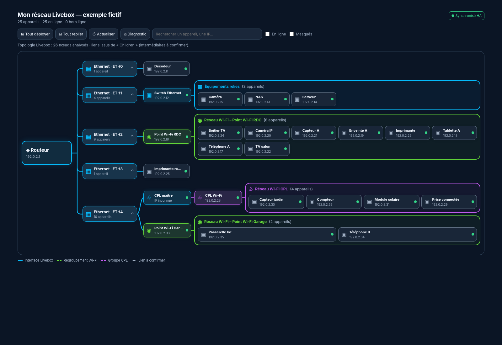

# Livebox Réseau — topologie pour Home Assistant

[](https://www.home-assistant.io/)
[](https://www.hacs.xyz/)


**Version 0.7.4 : testée sur Home Assistant avec une Livebox 7 réelle.** Les regroupements CPL `HomePlug`, les connexions Cudy et les clients Wi-Fi des Velop fournis par Linksys ont été contrôlés visuellement. Les cas non observés (par exemple une seconde radio CPL 5 GHz ou plusieurs nouveaux Cudy) restent à confirmer.

Carte Lovelace affichant les ports de la Livebox, les équipements reliés et la hiérarchie des connexions. Les lignes sont tracées automatiquement : pas besoin de disposer les appareils un par un. Les personnalisations restent partagées entre PC et mobile dans `.storage/livebox_reseau_map`.

## Aperçu de la carte réelle (données synthétiques)



*Capture réalisée avec le vrai JavaScript v0.7.4 et des appareils inventés, avec des adresses de documentation `192.0.2.0/24`. L'image n'est pas une maquette artistique et ne représente pas les appareils du réseau réel.*

## Dépendances

- **Obligatoire :** [Orange Livebox pour Home Assistant (`cyr-ius/hass-livebox-component`)](https://github.com/cyr-ius/hass-livebox-component), installée et configurée. L'API interne `TopologyDiagnostics` doit être accessible.
- **Facultative, mais recommandée pour les Velop :** [Linksys Velop (`uvjim/linksys_velop`)](https://github.com/uvjim/linksys_velop). Elle fournit les vrais clients Wi-Fi par nœud dans les capteurs `Connected Devices`.
- **Inutiles pour cette version :** HomePlug AV, TP-Link WPA Powerline, accès administrateur aux CPL ou configuration cloud.

## Fonctionnement de la v0.7.4

### 1. Topologie Orange — source principale

La hiérarchie est importée depuis `TopologyDiagnostics → Children`. **Aucune branche n'est imposée à ETH2, ETH3 ou ETH4** : déplacer un CPL, switch, répéteur ou point d'accès ne nécessite pas de modifier les règles.

Les nœuds matériels sont reconnus à l'aide du champ Orange **`DeviceType`**, notamment :

| Type Livebox | Représentation |
| --- | --- |
| `HomePlug` | Bulle violette (indépendamment du nom) |
| `ExtenderWiFiPlus` | Candidat Velop ; vert lorsque les associations sont disponibles |
| `Switch`, `Switch4`, `Switch8` | Intermédiaire identifié par Orange |
| `Access Point` | Appareil et liaison selon la topologie Orange |
| Autres | Appareil standard ; pas de nœud intermédiaire fictif |

**Exemple concret de structure :** sous un port ETH donné, `CPL Master`, `CPL Spare1` et `Device-2536` sont trois frères si la Livebox les décrit au même niveau. `Device-2536` est violet parce que son `DeviceType` vaut `HomePlug`, même si son nom ne contient pas « CPL ». Un Cudy déclaré dans ses `Children` s'affiche en dessous.

### 2. Interfaces radio d'un CPL

On conserve les entités de l'adaptateur physique et les interfaces radio, **sans les fusionner**. Les suffixes `_2.4` / `_5` (et quelques variantes orthographiques) ne servent qu'à associer les radios à un **parent déjà identifié comme `HomePlug` par Orange**. Ils ne servent pas à classifier un appareil comme CPL.

```text
Port ETH courant
├── Adaptateur CPL principal (HomePlug)
├── Adaptateur CPL Wi-Fi (HomePlug)
│   └── Réseau Wi-Fi CPL (cadre violet)
│       ├── Adaptateur Wi-Fi_2.4 → clients 2,4 GHz
│       └── Adaptateur Wi-Fi_5   → clients 5 GHz, si présent
└── Autre adaptateur CPL (HomePlug)
    └── Point d'accès extérieur (si Children le confirme)
```

Lorsque **une seule radio** est identifiée sous un adaptateur, les clients directs sous ce même adaptateur sont regroupés dans cette bande. Avec **plusieurs radios**, les clients non attribués explicitement par la Livebox restent sous l'adaptateur plutôt que d'être placés au hasard en 2,4 ou 5 GHz. La v0.7.4 ne sait pas interroger directement les clients Wi-Fi des CPL TP-Link.

### 3. Clients Velop — source Linksys

La carte détecte les capteurs Linksys `sensor.*connected_devices` dont l'attribut `devices` contient des clients. Le capteur est associé à un équipement Orange **déjà identifié comme `ExtenderWiFiPlus`** par la correspondance de son libellé `Connected Devices` et du nom du Velop. Les clients sont ensuite reliés par **MAC exacte**.

Seules les entrées Linksys `type: wireless` sont reconnues comme clients Wi-Fi du Velop. Les entrées `type: wired` (qui peuvent inclure d'autres équipements du LAN en mode pont) **ne sont pas regroupées sous ce Velop**. Si deux capteurs déclarent la même MAC, le rattachement est laissé incertain : on ne devine pas. Le détail de la fiche peut afficher la bande radio, le RSSI et le débit de liaison négocié.

**Limite :** si le capteur Linksys est renommé, absent ou ne fournit pas les clients, les associations Wi-Fi ne peuvent pas être garanties automatiquement. On conserve alors les relations `Children` de la Livebox et les corrections manuelles explicites.

### 4. Trackers désactivés

L'intégration lit également l'inventaire déjà présent dans le coordinateur de l'intégration Orange. Les nouveaux appareils peuvent donc être affichés **même si leur `device_tracker` est désactivé dans Home Assistant**, dès lors qu'ils sont connus d'Orange et identifiables par MAC. L'inventaire transmis au navigateur se limite au nom, MAC, IP, type, interface et état actif ; aucun mot de passe ou donnée d'authentification.

### 5. Rafraîchissement, confidentialité, synchronisation

- Cache partagé du diagnostic Orange pendant 15 minutes pour éviter de surcharger la Livebox.
- Bouton **Actualiser** : demande une lecture forcée, limitée côté serveur à **une fois toutes les 45 secondes**.
- Les données Linksys viennent des états Home Assistant existants et ne nécessitent pas de requête réseau supplémentaire depuis la carte.
- Diagnostic exportable **sans MAC ni adresses IP** (mais il conserve les noms, donc à vérifier avant partage public).
- Les préférences de nom, parent, groupe, masquage et type de lien sont sauvegardées dans HAOS et restent prioritaires sur les regroupements automatiques.
- Aucun changement au recorder, à MariaDB, aux équipements réseau ou à la politique de purge de Home Assistant.

## Installation avec HACS

1. Ajouter le dépôt GitHub `https://github.com/Stitchou/livebox-reseau` comme **intégration** personnalisée dans HACS si ce n'est pas déjà fait.
2. Installer ou mettre à jour vers la release **`v0.7.4`**.
3. Redémarrer uniquement **Home Assistant Core** pour recharger le code Python.
4. Vérifier l'URL de la ressource Lovelace : `/livebox-reseau/livebox-topologie-card.js?v=0.7.4`.
5. Recharger le navigateur (`Ctrl + Maj + R`) si l'ancienne carte est encore dans le cache.

Les mises à jour ne suppriment pas `.storage/livebox_reseau_map`. Une sauvegarde Home Assistant reste recommandée avant toute mise à jour.

## Validation et limites

Tests fournis dans `tests/` :

```bash
python -m compileall -q custom_components/livebox_reseau
pytest -q tests/test_topology.py tests/test_backend.py
node --check custom_components/livebox_reseau/frontend/livebox-topologie-card.js
node tests/test_v074_dynamic.cjs
node tests/test_grid_options.cjs
python tests/test_v074_ui.py        # Nécessite Playwright + Chromium
```

Les scénarios de test comprennent : trois HomePlug au même niveau, nouveau CPL de nom neutre, Cudy en descendant Orange, deux radios distinctes, déplacement ETH, clients Linksys Wi-Fi vs wired, conflit entre deux Velop, inventaire sans tracker et affichage mobile 375 px.

**Non vérifié :** fonctionnement de cette v0.7.4 sur le véritable firmware de la Livebox 7, avec les vrais états Home Assistant du foyer et des futurs CPL/Cudy. Le modèle d'attribution par fréquence reste limité par les détails réellement remontés dans `Children`.

## Documentation complémentaire

Historique : [CHANGELOG.md](CHANGELOG.md). Projet : [Stitchou/livebox-reseau](https://github.com/Stitchou/livebox-reseau).
